### Hi there 👋

### Latest posts
<!-- BLOGPOSTS:START -->
- [Agents are Moving to the Cloud, and so is the Orchestration](https://dkdevelopment.net/agents-are-moving-to-the-cloud/)
- [I built my own Coding Agent harness and orchestrator: Part 2](https://dkdevelopment.net/building-local-agent-box-pt2/)
- [I built my own Coding Agent harness and orchestrator: Part 1](https://dkdevelopment.net/building-local-agent-box-pt1/)
- [Building Nomii Without the Builder](https://dkdevelopment.net/nomii-from-draftbit-to-cursor-expo/)
- [ScaleBop: From Vibe to Viable](https://dkdevelopment.net/from-vibe-to-viable-scalebop/)
<!-- BLOGPOSTS:END -->

---

<picture>
  <source
    srcset="./profile/stats-dark.svg"
    media="(prefers-color-scheme: dark)"
  />
  <source
    srcset="./profile/stats-light.svg"
    media="(prefers-color-scheme: light), (prefers-color-scheme: no-preference)"
  />
  
</picture>

---

<picture>
  <source
    srcset="./profile/langs-dark.svg"
    media="(prefers-color-scheme: dark)"
  />
  <source
    srcset="./profile/langs-light.svg"
    media="(prefers-color-scheme: light), (prefers-color-scheme: no-preference)"
  />
  
</picture>